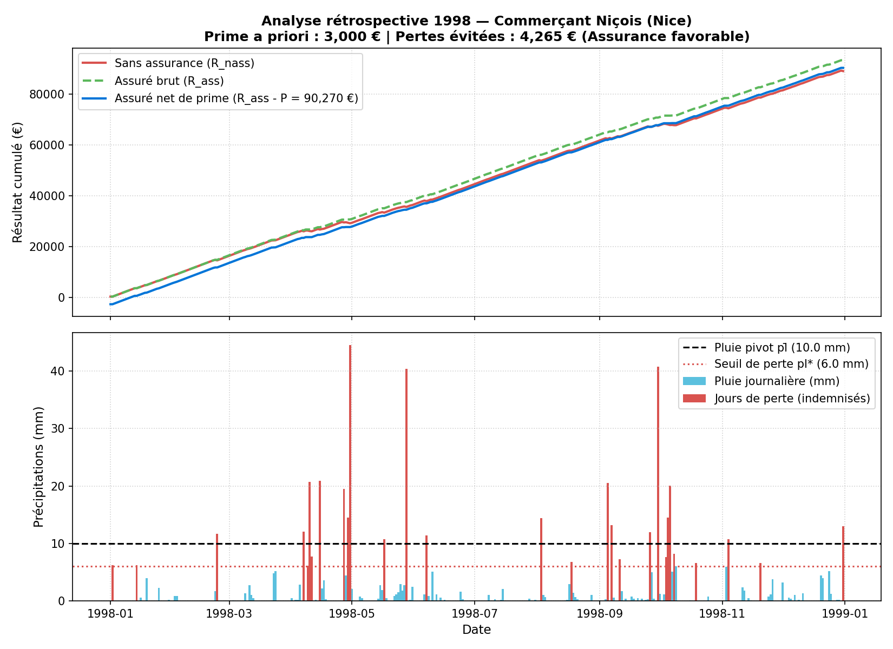

# Logiciel d'Assurance de Risque Météorologique

Projet d'actuariat — **Polytech Nice Sophia (MAM, parcours IMAFA 2026-2027)**.  
Enseignant : **Marius AKRE**

## Équipe
- Amiel Metier
- *(Membres du groupe)*

---

## Présentation du projet

Dans le cadre d'une création d'offre d'assurance paramétrique, ce projet vise à concevoir un logiciel complet de couverture contre les aléas météorologiques (en particulier la pluie) pour des commerçants dont l'activité dépend du climat.

L'objectif est de répondre aux besoins de trois départements de l'entreprise d'assurance :
1. **Département Tarification** : tarifer une assurance annuelle garantissant un résultat d'exploitation positif ($R \ge 0$) chaque jour de l'année.
2. **Département Commercial** : éditer et imprimer un devis clair pour le client (approche prospective).
3. **Département R&D** : réaliser une analyse rétrospective de l'impact de l'assurance sur une année passée au choix, illustrée graphiquement.

Le projet intègre également une **application web interactive (Streamlit)** responsive (mobile/desktop) et une connexion aux **données météo en temps réel et historiques** (API Open-Meteo, Infoclimat / NOAA).

---

## Modélisation mathématique et actuarielle

### 1. Activité du commerçant
Pour une journée $t$ avec un niveau pluviométrique $pl_t$ (en mm) et un niveau pivot $\overline{pl}$ fixé par le commerçant :
- **Chiffre d'affaires journalier ($CA_t^{pl}$)** :
  $$CA_t^{pl} = \begin{cases} 0 & \text{si } pl_t \ge \overline{pl} \\ f_t^{pl} \times CA & \text{si } 0 < pl_t < \overline{pl} \\ CA & \text{si } pl_t = 0 \end{cases} \quad \text{avec } f_t^{pl} = \frac{\overline{pl} - pl_t}{\overline{pl}}$$
- **Résultat journalier ($R_t^{pl}$)** avec coûts fixes journaliers $Cf$ ($CA > Cf$) :
  $$R_t^{pl} = CA_t^{pl} - Cf$$

### 2. Seuil de rentabilité journalier
Le commerçant subit une perte journalière ($R_t^{pl} < 0$) dès que la pluie dépasse le seuil critique :
$$pl^* = \overline{pl} \left(1 - \frac{Cf}{CA}\right)$$

### 3. Couverture d'assurance
Le contrat garantit un résultat positif ou nul ($R \ge 0$) pour chacun des 365 jours de l'année. L'indemnité journalière versée par l'assureur est donc :
$$I_t = \max(0, -R_t^{pl})$$

Le résultat annuel non assuré est $R_{nass} = \sum_{t=1}^{365} R_t^{pl}$, et le résultat garanti avec assurance est :
$$R_{ass} = \sum_{t=1}^{365} (R_t^{pl} + I_t) = R_{nass} + \sum_{t=1}^{365} I_t$$

### 4. Tarification annuelle (Pricing)
La **prime pure** annuelle correspond à l'espérance mathématique des pertes annuelles $\mathbb{E}[L]$ estimée sur l'historique climatique de la ville :
$$P_{pure} = \mathbb{E}\left[\sum_{t=1}^{365} I_t\right]$$
La prime commerciale finale intègre un chargement de sécurité ($\beta \cdot \sigma$) et un chargement pour frais de gestion ($\alpha \cdot P_{pure}$) :
$$P = P_{pure} + \beta \cdot \sigma(L) + \alpha \cdot P_{pure}$$

---

## Organisation du code

```
.
├── src/assurance_meteo/
│   ├── __init__.py
│   ├── model.py           # Modélisation client, CA, résultat et indemnisation
│   ├── weather.py         # Récupération météo temps réel & historique (Open-Meteo)
│   ├── pricing.py         # Tarification actuarielle (prime pure & chargements)
│   ├── devis.py           # Édition du devis client (Département commercial)
│   └── retrospective.py   # Analyse rétrospective & visualisations (Département R&D)
├── app.py                 # Interface Web & Mobile (Streamlit)
├── notebooks/
│   └── 01_tarification_et_analyse_retrospective.ipynb  # Démonstration et validation
├── data/
│   └── nice_1998_rain.csv # Données pluviométriques de référence (Nice 1998)
├── report/
│   └── figures/           # Graphiques générés pour le rapport
├── requirements.txt       # Dépendances Python
└── README.md
```

---

## Installation et exécution

### Prérequis
Python 3.10 ou supérieur.

```bash
# 1. Cloner le dépôt
git clone https://github.com/AmielMetier/PROJET-D-ACTUARIAT---IMAFA-2026-2027-LOGICIEL-D-ASSURANCE-DE-RISQUE-METEOROLOGIQUE.git
cd PROJET-D-ACTUARIAT---IMAFA-2026-2027-LOGICIEL-D-ASSURANCE-DE-RISQUE-METEOROLOGIQUE

# 2. Créer et activer l'environnement virtuel
python -m venv .venv
source .venv/bin/activate       # Sous Windows : .venv\Scripts\activate

# 3. Installer les dépendances
pip install -r requirements.txt
```

### Lancement de l'application Web (Streamlit)
```bash
streamlit run app.py
```
L'interface permet de tester interactivement la tarification, d'imprimer un devis et de visualiser l'analyse rétrospective sur n'importe quelle ville et année passée.

### Lancement du Notebook
```bash
jupyter lab notebooks/01_tarification_et_analyse_retrospective.ipynb
```

---

## Exemple d'analyse rétrospective (Nice, 1998)

Conformément à l'exemple d'illustration du sujet :
- **Paramètres client** : Ville de Nice, $\overline{pl} = 10\text{ mm}$, $CA = 500\text{ €/j}$, $Cf = 200\text{ €/j}$ (soit $pl^* = 6\text{ mm/j}$).
- **Résultat non assuré ($R_{nass}^{1998}$)** : $\approx 89\,000\text{ €}$.
- **Prime payée a priori ($P^{1998}$)** : $3\,000\text{ €}$.
- **Pertes subies évitées** : $\approx 4\,265\text{ €}$.
- **Résultat net assuré ($R_{ass} - P$)** : $\approx 90\,270\text{ €}$.

**Conclusion rétrospective** : S'assurer en 1998 a été financièrement favorable au commerçant niçois, la prime versée ($3\,000\text{ €}$) étant inférieure aux pertes réelles générées par les intempéries ($4\,265\text{ €}$).



---

## Calendrier du projet

- **6 novembre 2026** : Envoi de la composition des groupes.
- **17 novembre 2026** : Présentation de la version DRAFT (10 min).
- **15 décembre 2026** : Présentation finale (10 min) et remise du livrable (code + guide utilisateur).

---

## Sources et références
- Données historiques & prévisions en temps réel : [Open-Meteo API](https://open-meteo.com)
- Climatologie et stations françaises : [Infoclimat](https://www.infoclimat.fr)
- Archives climatiques internationales : [NOAA / NCEI](https://www.ncei.noaa.gov)
