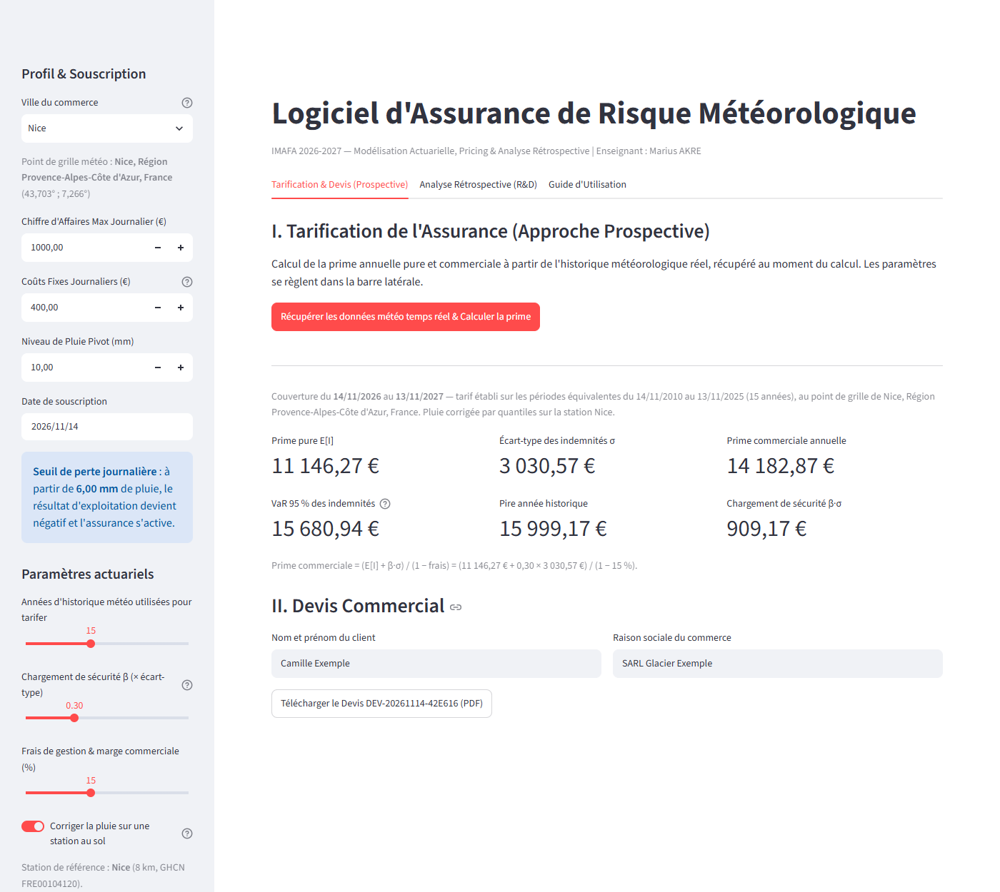
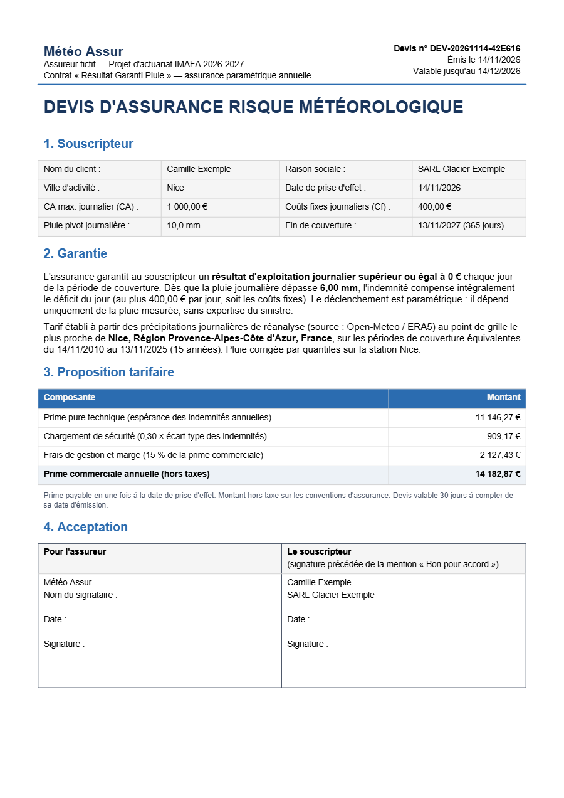
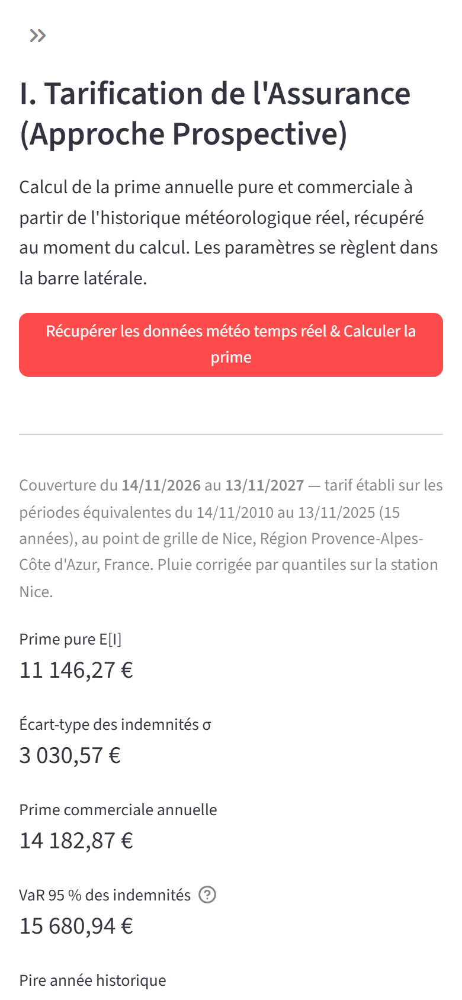
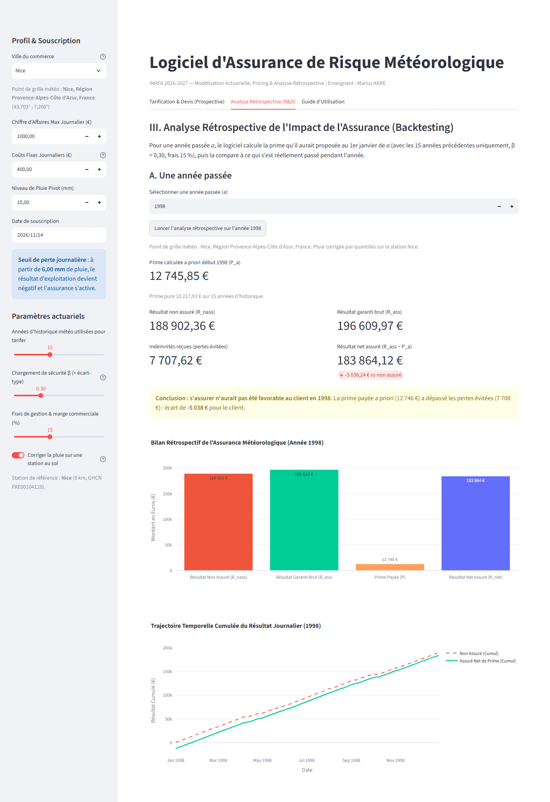
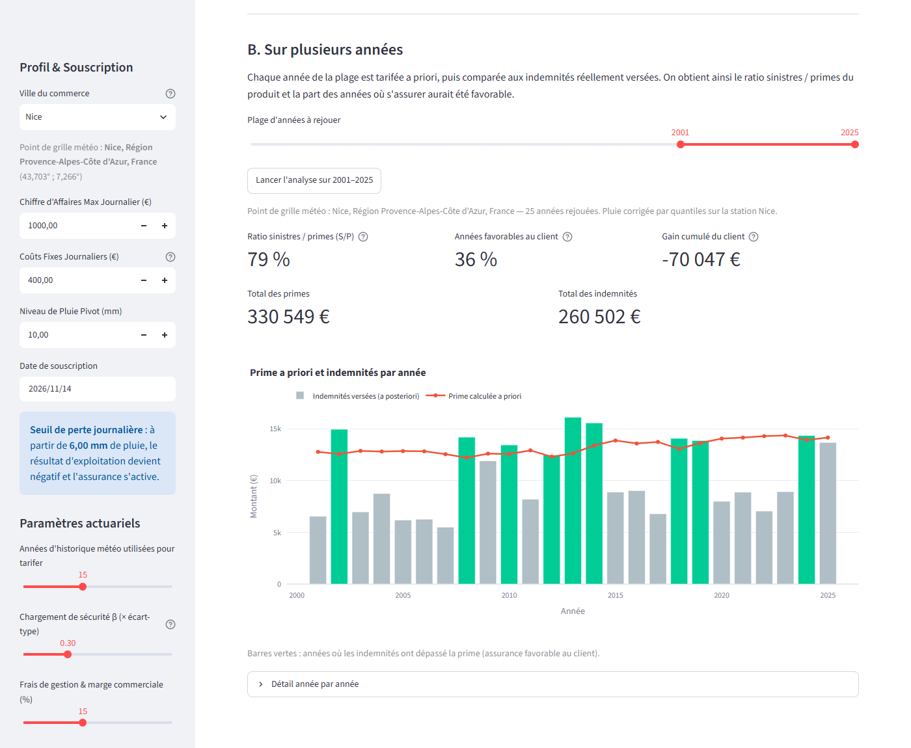

# Logiciel d'Assurance de Risque Météorologique

Projet d'actuariat — **Polytech Nice Sophia (MAM, parcours IMAFA 2026-2027)**.  
Enseignant : **Marius AKRE**

## Application en ligne

**[https://ggg-imafa-logiciel-d-assurance-de-risque-meteorologique.streamlit.app/](https://ggg-imafa-logiciel-d-assurance-de-risque-meteorologique.streamlit.app/)**

Utilisable directement depuis un navigateur d'ordinateur ou de téléphone, sans installation. Scannez le QR code avec l'appareil photo d'un smartphone pour l'ouvrir :


> Hébergée gratuitement sur Streamlit Community Cloud : après quelques jours sans visite, l'application se met en veille et le premier visiteur doit cliquer sur « Yes, get this app back up! » puis patienter environ une minute.

## Aperçu

Captures réalisées avec un client fictif (Camille Exemple, SARL Glacier Exemple), à Nice, avec les paramètres par défaut.

**Tarification et devis** : profil du commerce et paramètres actuariels dans la barre latérale, prime calculée sur la météo réelle.



<table>
<tr>
<td width="62%"><b>Devis PDF</b> téléchargé depuis l'application<br></td>
<td width="38%"><b>Sur téléphone</b> (barre latérale repliée)<br></td>
</tr>
</table>

**Analyse rétrospective sur une année** : prime calculée a priori au 1er janvier 1998, résultats réels de l'année et conclusion.



**Analyse rétrospective sur plusieurs années** : ratio sinistres / primes et années favorables au client (en vert).



## Équipe
- Amiel Metier
- Tahitoa Senis
- Nicolas Muratore
- Lucas Diguet
- Gabriel Ferré

---

## Présentation du projet

Dans le cadre d'une création d'offre d'assurance paramétrique, ce projet a pour objectif de concevoir un logiciel complet de couverture contre les aléas météorologiques (notamment le risque de pluie) pour des commerçants dont l'activité dépend directement de la météo.

Le logiciel répond aux exigences des trois départements de la compagnie :
1. **Département Tarification (Pricing)** : calculer la prime d'assurance annuelle garantissant un résultat d'exploitation positif ($R \ge 0$) pour chacun des 365 jours suivant la date de souscription.
2. **Département Commercial (Devis)** : générer et imprimer un devis contractuel au format **PDF** (bloc assureur, identité du client, garantie, détail de la prime, zone de signature).
3. **Département R&D (Analyse Rétrospective)** : comparer sur n'importe quelle année passée $a$ le résultat non assuré ($R_{nass}$), le résultat garanti ($R_{ass}$) et la prime calculée a priori ($P_a$), puis rejouer le contrat sur plusieurs années (ratio sinistres / primes, part des années favorables au client), avec graphiques interactifs.

Le projet met également l'accent sur les critères de valorisation du barème :
- **Digitalisation & Responsive Web/Mobile** : interface web développée avec **Streamlit** et visualisations **Plotly**, utilisable depuis un ordinateur ou un téléphone.
- **Données Météorologiques en Temps Réel** : précipitations journalières téléchargées au moment du calcul depuis l'API Open-Meteo (réanalyses ERA5, point de grille le plus proche de la ville), sans clé d'API, puis **corrigées sur la station au sol la plus proche** (méthode des quantiles, 25 villes calées sur les relevés NCEI, correction activée par défaut dans les 14 où elle améliore le tarif), ce qui supprime l'essentiel du surcoût d'environ 13 % de la réanalyse.

---

## Modélisation mathématique et actuarielle

### 1. Activité économique du commerçant
Pour une journée $t$, avec une pluviométrie $pl_t$ (en mm) et un seuil pivot $\overline{pl}$ fixé par le commerçant :
- **Chiffre d'affaires journalier ($CA_t^{pl}$)** :
  $$CA_t^{pl} = \begin{cases} 0 & \text{si } pl_t \ge \overline{pl} \\ f_t^{pl} \times CA & \text{si } 0 < pl_t < \overline{pl} \\ CA & \text{si } pl_t = 0 \end{cases} \quad \text{avec } f_t^{pl} = \frac{\overline{pl} - pl_t}{\overline{pl}}$$
- **Résultat journalier ($R_t^{pl}$)** avec coûts fixes journaliers incompressibles $Cf$ ($CA > Cf$) :
  $$R_t^{pl} = CA_t^{pl} - Cf$$

### 2. Seuil de rentabilité journalier
Le commerçant subit une perte d'exploitation ($R_t^{pl} < 0$) dès que la pluie franchit le seuil critique :
$$pl^* = \overline{pl} \left(1 - \frac{Cf}{CA}\right)$$

### 3. Couverture d'assurance et indemnisation
Le contrat garantit un résultat journalier positif ou nul ($R \ge 0$). L'indemnité journalière versée par l'assureur est donc :
$$I_t = \max(0, -R_t^{pl})$$

Sur l'ensemble des 365 jours, le résultat non assuré et le résultat garanti brut sont :
$$R_{nass} = \sum_{t=1}^{365} R_t^{pl}, \qquad R_{ass} = \sum_{t=1}^{365} (R_t^{pl} + I_t) = R_{nass} + \sum_{t=1}^{365} I_t$$

### 4. Tarification prospective (Pricing)
L'indemnité annuelle $I = \sum_{t=1}^{365} I_t$ est rejouée sur les $N$ années d'historique, chacune découpée en périodes de 365 jours commençant au jour de la souscription. La **prime pure technique** est son espérance, estimée par la moyenne historique :
$$P_{pure} = \mathbb{E}[I]$$
La prime commerciale annuelle applique le **principe de l'écart-type** (le chargement de sécurité croît avec la volatilité climatique) puis les frais de gestion et la marge :
$$P = \frac{\mathbb{E}[I] + \beta \cdot \sigma(I)}{1 - \alpha}$$
*(où $\beta$ est le coefficient de chargement de sécurité, 0,30 par défaut, et $\alpha$ le taux de frais de gestion).*

Le choix $\beta = 0{,}30$ est justifié par un backtest sur 2001-2025 : sans chargement, le produit aurait perdu de l'argent à Nice, Brest et Strasbourg ; avec 0,30, il est rentable à Nice et Strasbourg pour un chargement de 6 à 10 % de la prime pure. La VaR 95 % des indemnités est affichée à titre indicatif : estimée sur 15 années, elle est peu fiable et n'entre pas dans la prime. Détails dans la section 4 du [guide](docs/USER_GUIDE.md).

### 5. Analyse rétrospective
Pour une année passée $a$, la prime $P_a$ est calculée **a priori**, comme au 1er janvier de $a$, avec les seules années antérieures. Elle est ensuite comparée aux résultats réellement observés pendant $a$ : s'assurer a été favorable si les indemnités reçues dépassent $P_a$.

---

## Organisation du code

```
.
├── src/
│   ├── __init__.py
│   ├── simulation.py      # Modèle client, CA journalier, résultat et calcul des indemnités
│   ├── pricing.py         # Périodes de couverture de 365 jours et tarification (E[I], σ, VaR, chargements)
│   ├── weather_api.py     # Géocodage et précipitations Open-Meteo (nouvelles tentatives, erreurs lisibles)
│   ├── bias_correction.py # Correction de la pluie par quantiles, calée sur les stations au sol
│   ├── cities.py          # Villes du menu déroulant
│   ├── pdf_generator.py   # Devis au format PDF (ReportLab)
│   ├── backtesting.py     # Analyse rétrospective sur une ou plusieurs années
│   ├── visualisations.py  # Graphiques interactifs (Plotly)
│   └── formatting.py      # Montants au format français
├── app.py                 # Interface Web & Mobile complète (Streamlit)
├── notebooks/
│   └── 01_tarification_et_analyse_retrospective.ipynb  # Démonstration et validation pas-à-pas
├── tests/                 # Tests unitaires automatisés (Pytest, fonctionnent hors ligne)
├── data/
│   ├── nice_1998_rain.csv # Pluie réelle de Nice en 1998 (test de non-régression hors ligne)
│   └── calibration_stations.json # Tables de correction des 25 villes calées sur une station
├── docs/
│   ├── USER_GUIDE.md      # Manuel d'utilisation complet du logiciel
│   └── USER_GUIDE.pdf     # Version PDF du manuel (envoi par mail)
├── scripts/
│   ├── generer_guide_pdf.py     # Génère docs/USER_GUIDE.pdf
│   ├── comparaison_station.py   # Compare Open-Meteo à la station Nice-aéroport (NCEI)
│   └── calibrer_correction.py   # Calcule les tables de correction des villes du menu
├── report/figures/        # Captures d'écran, QR code et figures
├── PROJET-ACTUARIAT- LOGICIEL D ASSURANCE DE RISQUE METEOROLOGIQUE.pdf # Sujet officiel
├── requirements.txt       # Dépendances de l'application (versions figées)
├── requirements-dev.txt   # Outils en plus : notebook, figures, guide PDF
└── README.md
```

---

## Installation et démarrage rapide

### Prérequis
Python 3.11 et une connexion Internet (données météo récupérées au moment du calcul).

```bash
# 1. Cloner le dépôt
git clone https://github.com/AmielMetier/PROJET-D-ACTUARIAT---IMAFA-2026-2027-LOGICIEL-D-ASSURANCE-DE-RISQUE-METEOROLOGIQUE.git
cd PROJET-D-ACTUARIAT---IMAFA-2026-2027-LOGICIEL-D-ASSURANCE-DE-RISQUE-METEOROLOGIQUE

# 2. Créer et activer l'environnement virtuel
python -m venv .venv
source .venv/bin/activate       # Sous Windows : .venv\Scripts\activate

# 3. Installer les dépendances
pip install -r requirements.txt
```

### Lancement de l'Application Web (Streamlit)
```bash
streamlit run app.py
```
L'application s'ouvre à l'adresse `http://localhost:8501` (la version en ligne, identique, est sur [ggg-imafa-logiciel-d-assurance-de-risque-meteorologique.streamlit.app](https://ggg-imafa-logiciel-d-assurance-de-risque-meteorologique.streamlit.app/)). Elle propose :
- dans la barre latérale, le profil du commerçant (ville, CA, coûts fixes, pluie pivot, date de souscription) et les paramètres actuariels (historique, β, frais) ;
- la tarification prospective avec téléchargement du **devis en PDF** ;
- l'analyse rétrospective sur une année ou sur une plage d'années, avec graphiques ;
- le guide d'utilisation intégré.

### Lancement des Notebooks
Le notebook et les scripts d'analyse demandent quelques outils de plus (JupyterLab, Matplotlib) :
```bash
pip install -r requirements-dev.txt
jupyter lab notebooks/01_tarification_et_analyse_retrospective.ipynb
```

### Exécution des Tests Unitaires
```bash
python -m pytest tests/
```

---

## Exemple d'analyse rétrospective (Nice, 1998)

Les montants de l'exemple du sujet (résultat non assuré de 90 000 €, prime de 3 000 €, pertes évitées de 5 000 €) sont **illustratifs**. Avec la météo réelle de Nice et les paramètres ci-dessous, le logiciel obtient :

- **Paramètres client** : Nice, $\overline{pl} = 10\text{ mm}$, $CA = 1\,000\text{ €/j}$, $Cf = 400\text{ €/j}$ (seuil de perte $pl^* = 6\text{ mm/j}$) ; prime calculée sur 1983-1997, $\beta = 0{,}30$, frais 15 %, pluie corrigée sur la station de Nice-aéroport.
- **Prime calculée a priori ($P_{1998}$)** : $12\,746\text{ €}$.
- **Résultat non assuré ($R_{nass}$)** : $188\,902\text{ €}$ ; **résultat garanti brut ($R_{ass}$)** : $196\,610\text{ €}$.
- **Pertes évitées grâce à l'assurance** : $7\,708\text{ €}$.
- **Résultat net assuré ($R_{ass} - P_{1998}$)** : $183\,864\text{ €}$.

**Conclusion rétrospective** : en 1998, année moins pluvieuse que la moyenne des quinze précédentes, s'assurer n'aurait **pas** été favorable au commerçant (−5 038 €). Sur 2001-2025, le ratio sinistres / primes du produit est de 79 % et l'assurance a été favorable au client un peu plus d'une année sur trois : la prime est une moyenne, trop chère les années sèches et avantageuse les années pluvieuses.

---

## Calendrier des livrables

- **6 novembre 2026** : Envoi de la composition des groupes.
- **17 novembre 2026** : Présentation de la version DRAFT (10 min).
- **15 décembre 2026** : Présentation finale (10 min) et remise du livrable (code/logiciel + user guide).

---

## Sources et références
- Données historiques en temps réel : [Open-Meteo API](https://open-meteo.com) (réanalyses ERA5 / ERA5-Land)
- Climatologie France : [Infoclimat](https://www.infoclimat.fr)
- National Centers for Environmental Information : [NOAA / NCEI](https://www.ncei.noaa.gov)

Pour la documentation complète, les formules et les limites de la source météo, consultez le [Manuel d'Utilisation](docs/USER_GUIDE.md).
