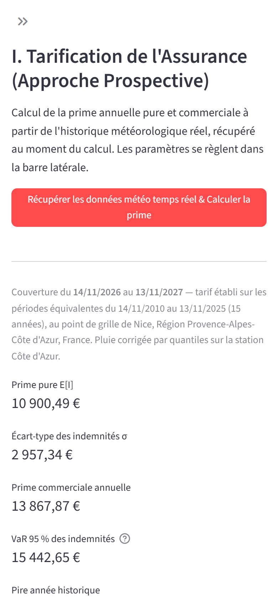
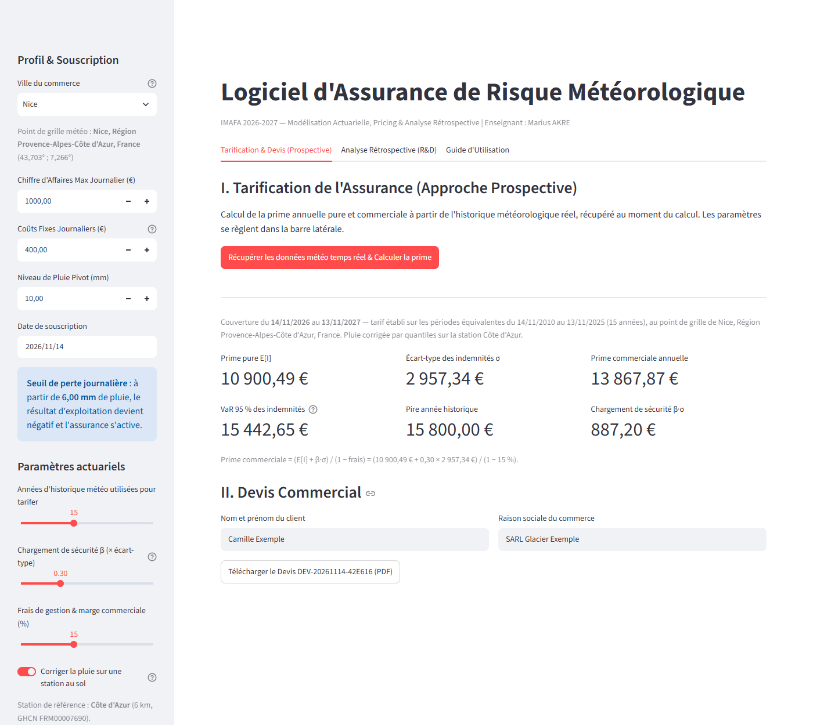
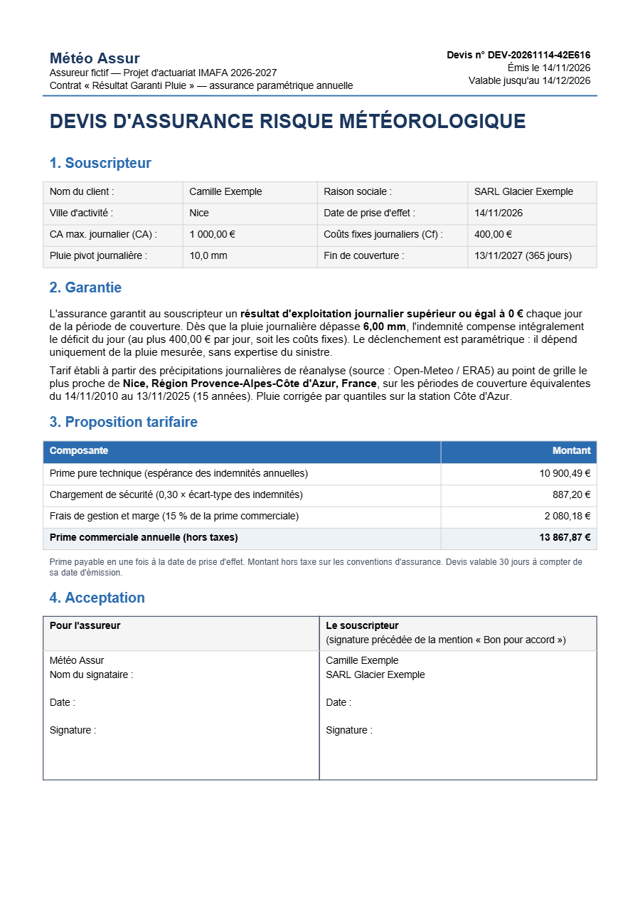
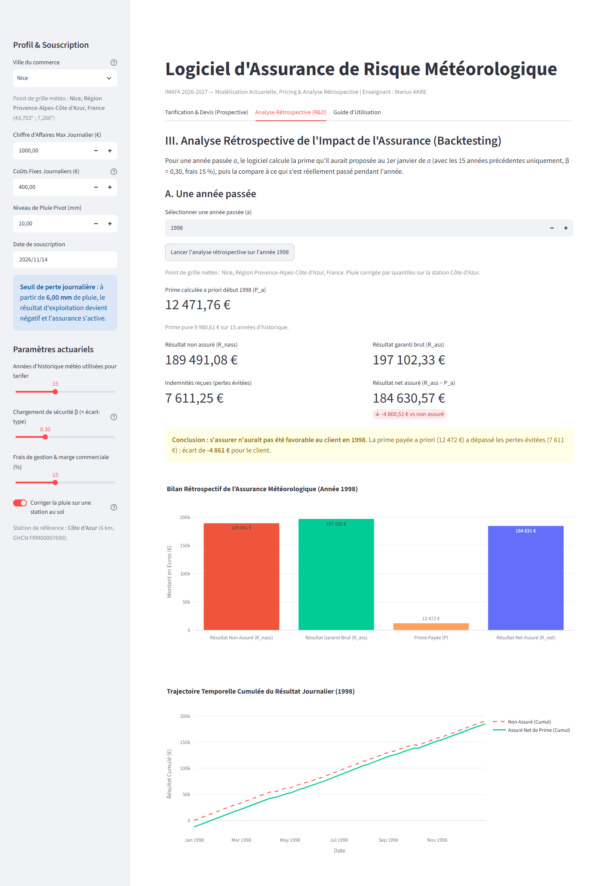
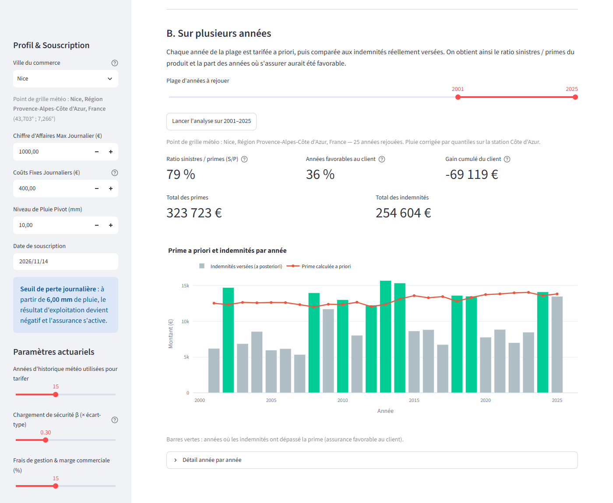
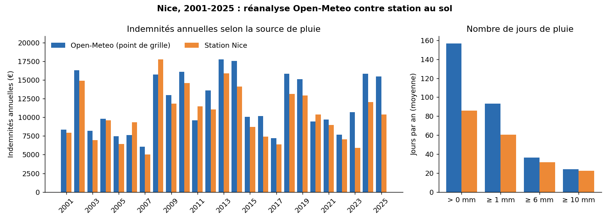

# Manuel d'Utilisation (User Guide)
## Logiciel d'Assurance de Risque Météorologique
**Polytech Nice Sophia (MAM, parcours IMAFA 2026-2027)**  
Équipe : Amiel Metier, Tahitoa Senis, Nicolas Muratore, Lucas Diguet, Gabriel Ferré  
Enseignant : Marius AKRE

---

### 1. Présentation du Logiciel

Le logiciel permet à une compagnie ou un courtier d'assurance de tarifer et de simuler des contrats d'assurance indicielle (paramétrique) contre les aléas pluviométriques pour des commerçants dont l'activité dépend de la météo.

Il intègre 3 volets fondamentaux :
1. **Département Tarification (Pricing)** : Tarification prospective de la prime pure et commerciale grâce aux données météorologiques réelles interrogées en temps réel.
2. **Département Commercial (Devis)** : Génération automatisée et impression d'un devis contractuel au format PDF.
3. **Département R&D (Analyse Rétrospective / Backtesting)** : Évaluation a posteriori sur n'importe quelle année passée $a$ pour vérifier la rentabilité de l'assurance pour le client et visualiser les trajectoires de résultats.

---

### 2. Accès à l'application

#### En ligne (recommandé)
L'application est accessible sans installation, sur ordinateur comme sur smartphone ou tablette :

**[https://ggg-imafa-logiciel-d-assurance-de-risque-meteorologique.streamlit.app/](https://ggg-imafa-logiciel-d-assurance-de-risque-meteorologique.streamlit.app/)**


Scannez le QR code avec l'appareil photo d'un smartphone pour ouvrir l'application. Elle est hébergée gratuitement sur Streamlit Community Cloud : après quelques jours sans visite, elle se met en veille ; cliquez alors sur « Yes, get this app back up! » et patientez environ une minute.

#### En local (installation)

##### Prérequis
- Python 3.11 (versions des bibliothèques figées dans `requirements.txt`)
- Connexion Internet (pour la récupération temps réel des séries météo)

##### Installation des dépendances
Dans un terminal à la racine du projet :
```bash
pip install -r requirements.txt
```

##### Lancement de l'Application Web
```bash
streamlit run app.py
```
L'interface s'ouvre automatiquement dans votre navigateur par défaut à l'adresse `http://localhost:8501`. L'interface est conçue pour être "responsive" et utilisable sur ordinateur comme sur smartphone/tablette.

---

### 3. Guide Pas à Pas

#### Étape 1 : Profil client et paramètres (barre latérale)


> Sur téléphone (figure 1, à droite), la barre latérale est repliée au démarrage : touchez le symbole » en haut à gauche pour l'ouvrir, puis touchez à côté pour la refermer.

Dans la barre latérale gauche, renseignez les paramètres du commerçant :
- **Ville du commerce** : choisissez-la dans le menu déroulant (44 grandes villes françaises, triées par ordre alphabétique ; tapez les premières lettres pour filtrer la liste). Si la ville n'y figure pas, tapez son nom en entier puis validez avec Entrée : n'importe quelle ville reconnue par le service météo est acceptée (ex. *Lorient*).
  - La recherche se fait d'abord **en France**, puis dans le monde entier si rien n'est trouvé ; en cas d'homonymes, la commune la plus peuplée est retenue.
  - La localité retenue et ses coordonnées s'affichent sous le champ (« Point de grille météo ») : vérifiez-la avant de tarifer.
- **Chiffre d'affaires journalier maximal ($CA$)** : réalisé par temps sec.
- **Coûts fixes journaliers ($Cf$)** : frais incompressibles quotidiens. Le champ est automatiquement limité à $CA - 1$ € ($CA > Cf$).
- **Niveau de pluie pivot ($\bar{pl}$)** : seuil journalier en millimètres au-delà duquel l'activité s'arrête ($CA = 0$).
- **Date de souscription** (aujourd'hui ou plus tard).

> Le logiciel calcule immédiatement le **seuil critique de perte journalière** :
> $$pl_{\text{seuil}} = \bar{pl} \times \left(1 - \frac{Cf}{CA}\right)$$

Plus bas, la rubrique **Paramètres actuariels** sert aux deux onglets de calcul :
- **Années d'historique** (5 à 30) utilisées pour estimer la prime ;
- **Chargement de sécurité β** : multiplicateur de l'écart-type des indemnités annuelles (0,30 par défaut) ;
- **Frais de gestion et marge** (en % de la prime commerciale) ;
- **Corriger la pluie sur une station au sol** (activé par défaut) : la pluie de réanalyse est recalée sur les relevés de la station météo la plus proche, ce qui supprime le surcoût d'environ 13 % constaté à Nice (section 5). La station utilisée et sa distance s'affichent sous l'interrupteur ; pour les villes sans station de référence, la pluie n'est pas corrigée et l'application le signale.

#### Étape 2 : Tarification prospective et devis (onglet 1)
1. Cliquez sur **« Récupérer les données météo temps réel & Calculer la prime »**.
   - Le contrat couvre les **365 jours à partir de la date de souscription**.
   - La prime est estimée sur les périodes équivalentes des années passées : pour une souscription au 13/11, chaque année d'historique va du 13/11 au 12/11 suivant. Chaque période compte **365 jours**, comme le contrat, même si elle contient un 29 février. Seules les périodes complètes sont retenues.
   - Les jours sans donnée météo sont comptés comme secs et signalés par un avertissement ; une période où plus de 5 % des jours manquent est écartée.
2. Les indicateurs actuariels s'affichent :
   - prime pure $E[I]$ (moyenne des indemnités annuelles) et écart-type $\sigma(I)$ ;
   - **VaR 95 %** (indemnités annuelles dépassées une année sur vingt en moyenne) et pire année historique ;
   - chargement de sécurité $\beta \cdot \sigma(I)$ et prime commerciale :
   $$P = \frac{E[I] + \beta\,\sigma(I)}{1 - \text{frais}}$$
   Ce **principe de l'écart-type** fait payer davantage un risque irrégulier qu'un risque stable de même moyenne.

<p align="center"></p>
<p align="center"><em>Figure 2 — Onglet Tarification : profil et paramètres dans la barre latérale, indicateurs actuariels et champs du devis (client fictif).</em></p>
3. Saisissez le **nom du client** et la **raison sociale** du commerce, puis cliquez sur **« Télécharger le Devis »**. Le PDF contient : le bloc assureur, la référence unique (`DEV-AAAAMMJJ-XXXXXX`) et la date de validité, les données du souscripteur, la garantie, le détail de la prime et une **zone de signature** pour chaque partie.

<p align="center"></p>
<p align="center"><em>Figure 3 — Première page du devis PDF généré par l'application (client fictif).</em></p>

> Si vous modifiez un paramètre (profil client ou paramètres actuariels) après le calcul, le devis est masqué jusqu'à ce que vous recalculiez la prime : un devis ne peut donc jamais associer un profil à la prime d'un autre. Le nom et la raison sociale, eux, peuvent être changés sans recalcul.
>
> Si le service météo est injoignable, le logiciel réessaie 3 fois puis affiche un message d'erreur au lieu de planter.

#### Étape 3 : Analyse rétrospective (onglet 2)
**A. Une année passée $a$**
1. Choisissez une année (ex. 1998 ; les archives commencent en 1940).
2. Cliquez sur **« Lancer l'analyse rétrospective »**. La prime $P_a$ n'est pas à saisir : le logiciel la calcule **a priori**, comme au 1er janvier de $a$, avec les seules années antérieures (et les paramètres actuariels de la barre latérale).
3. Le logiciel affiche $R_{nass}$, $R_{ass}$, $P_a$, $R_{ass} - P_a$, la conclusion (assurance favorable ou non) et deux graphiques : le bilan annuel en barres et la trajectoire cumulée jour par jour.

<p align="center"></p>
<p align="center"><em>Figure 4 — Analyse rétrospective de 1998 à Nice : prime calculée a priori, résultats réels et conclusion.</em></p>

**B. Sur plusieurs années**
1. Choisissez une plage d'années (25 dernières années par défaut) et lancez l'analyse.
2. Chaque année est tarifée a priori puis comparée aux indemnités réellement versées. Le logiciel affiche :
   - le **ratio sinistres / primes (S/P)** : indemnités versées divisées par primes encaissées. Sous 100 %, le produit est rentable pour l'assureur ;
   - la **part des années favorables** au client (indemnités supérieures à la prime) ;
   - le gain cumulé du client, les totaux de primes et d'indemnités ;
   - un graphique prime contre indemnités année par année, et le tableau détaillé.

<p align="center"></p>
<p align="center"><em>Figure 5 — Analyse sur 2001-2025 : ratio sinistres / primes, années favorables au client (en vert).</em></p>

> Les résultats restent affichés tant que les paramètres qui les influencent ne changent pas (vous pouvez passer d'un onglet à l'autre ou remplir le devis sans les perdre). Si un paramètre change, un message invite à relancer l'analyse.

---

### 4. Choix du chargement de sécurité et fiabilité des indicateurs

#### Pourquoi $\beta = 0{,}30$ ?
La prime commerciale vaut $P = \dfrac{E[I] + \beta\,\sigma(I)}{1 - \alpha}$, avec des frais $\alpha = 15\,\%$. Les frais étant prélevés sur la prime, l'assureur gagne de l'argent si les indemnités versées restent inférieures à la **prime nette de frais** $P(1 - \alpha)$. L'indicateur à suivre est donc le rapport **sinistres / prime nette de frais** : au-dessus de 100 %, le produit perd de l'argent.

Pour choisir $\beta$, le contrat a été rejoué sur **2001-2025** (chaque année tarifée a priori avec les 15 années précédentes, profil par défaut : CA 1 000 €, Cf 400 €, pivot 10 mm, pluie corrigée sur la station la plus proche) dans trois climats différents :

| $\beta$ | Nice : sinistres / prime nette | Nice : années favorables au client | Brest | Strasbourg | Chargement en % de la prime pure |
|---|---|---|---|---|---|
| 0 | 101 % | 44 % | 110 % | 101 % | 0 % |
| 0,30 | **92 %** | **36 %** | 104 % | **94 %** | 6 à 10 % |
| 0,50 | 88 % | 16 % | 101 % | 90 % | 10 à 16 % |
| 1 | 77 % | 8 % | 93 % | 82 % | 19 à 32 % |

Ce qu'on en retient :
- **Sans chargement ($\beta = 0$), le produit perd de l'argent** dans les trois villes. La prime pure est estimée sur les 15 années passées et les années récentes ont souvent été plus pluvieuses : l'estimation a priori est en retard sur le risque réel. Un chargement de sécurité est donc indispensable.
- **$\beta = 0{,}30$ est la valeur la plus basse testée qui rend le produit rentable à Nice et à Strasbourg** (92 % et 94 %), pour un supplément modéré de 6 à 10 % de la prime pure. Le client garde un intérêt réel : à Nice, l'assurance lui a été favorable plus d'une année sur trois.
- Au-delà, la prime devient chère pour le client : avec $\beta = 1$, l'assurance n'est presque plus jamais favorable à Nice (8 % des années).
- **Limite** : à Brest, climat plus pluvieux et plus irrégulier, $\beta = 0{,}30$ ne suffit pas (104 %) ; il faudrait $\beta \approx 1$. En pratique, $\beta$ devrait être ajusté par région, ce que permet le curseur de la barre latérale.

Ces conclusions sont les mêmes sans la correction de la pluie (101 / 93 / 88 / 78 % à Nice).

Interprétation : si les indemnités annuelles suivaient une loi normale, $E[I] + 0{,}30\,\sigma(I)$ correspondrait à leur 62e centile, soit une prime chargée dépassée environ quatre années sur dix.

#### Fragilité de la VaR 95 %
La **VaR 95 %** (montant d'indemnités dépassé une année sur vingt) est affichée, mais elle est **peu fiable** avec 15 années d'historique :
- avec 15 valeurs, le 95e centile se calcule par interpolation entre la 14e et la 15e valeur classées, c'est-à-dire entre **les deux plus fortes années** de l'échantillon : il dépend presque entièrement de deux observations ;
- il varie beaucoup selon la période retenue : selon la fenêtre de 15 ans choisie entre 1986 et 2025, il va de 13 009 € à 15 434 € à Nice (+19 %), et de **22 075 € à 30 355 €** à Brest (+38 %) ;
- un rééchantillonnage (bootstrap) de la période 2011-2025 donne un intervalle de confiance à 90 % de 27 002 € à 32 365 € à Brest.

C'est pourquoi la VaR n'entre pas dans le calcul de la prime : elle sert seulement à illustrer l'ordre de grandeur d'une mauvaise année. La prime repose sur la moyenne et l'écart-type, bien plus stables sur 15 années. Une estimation fiable de la VaR demanderait un historique plus long (le curseur va jusqu'à 30 ans) ou l'ajustement d'une loi sur les indemnités annuelles.

---

### 5. Source des données météo et limites

Les précipitations sont téléchargées au moment du calcul depuis **Open-Meteo** (API gratuite, sans clé), qui s'appuie sur les **réanalyses ERA5 et ERA5-Land** du centre européen ECMWF.

- Ce ne sont **pas les relevés d'une station au sol** : ce sont des valeurs calculées sur un **point de grille** d'environ 10 à 25 km de côté, le plus proche de la ville choisie. Le logiciel parle donc de « point de grille », pas de station.
- Les réanalyses ont tendance à **lisser les fortes pluies** (les orages locaux sont sous-estimés) et à compter **trop de jours de pluie faible** (bruine répartie sur toute la maille).
- Dans ce modèle, **toute pluie réduit le chiffre d'affaires** et seuls les jours au-delà du seuil critique déclenchent une indemnité : le nombre de jours pluvieux et l'intensité des épisodes pèsent donc directement sur la prime. Selon la ville, le premier biais tend à sous-estimer la prime, le second peut la surestimer.

#### Comparaison avec une station au sol (Nice, 2001-2025)
Pour mesurer ces biais, les données utilisées par le logiciel ont été comparées aux relevés de la station **Nice-aéroport** (identifiant GHCN-Daily `FRE00104120`, relevés Météo-France diffusés par le [NCEI](https://www.ncei.noaa.gov), source citée par le sujet), sur 25 années complètes, sans aucun jour manquant. Le calcul se refait avec `python scripts/comparaison_station.py`.

| Moyenne annuelle (profil par défaut) | Open-Meteo brut | Open-Meteo corrigé | Station Nice-aéroport | Écart brut | Écart corrigé |
|---|---|---|---|---|---|
| Cumul de pluie | 821 mm | 700 mm | 714 mm | +15 % | −2 % |
| Jours avec pluie (> 0 mm) | 157 | 88 | 86 | **+83 %** | +2 % |
| Jours ≥ 1 mm | 93 | 60 | 61 | +54 % | −2 % |
| Jours ≥ 6 mm (seuil de perte) | 36,3 | 30,6 | 31,2 | +16 % | −2 % |
| Jours ≥ 10 mm (activité arrêtée) | 24,2 | 21,8 | 22,3 | +9 % | −2 % |
| Pluie journalière maximale | 61,7 mm | 68,0 mm | 69,3 mm | −11 % | −2 % |
| Prime pure $E[I]$ | 11 782 € | 10 184 € | 10 415 € | +13 % | −2 % |
| Prime commerciale | 15 196 € | 13 193 € | 13 463 € | **+13 %** | **−2 %** |
| Résultat annuel non assuré | 168 071 € | 181 625 € | 180 972 € | −7 % | 0 % |

<p align="center"></p>
<p align="center"><em>Figure 6 — Nice, 2001-2025 : indemnités annuelles et jours de pluie selon la source (réanalyse ou station).</em></p>

Ce qu'on en retient :
- **Les deux biais attendus sont bien présents.** La réanalyse compte presque deux fois plus de jours de pluie que la station (157 contre 86 par an), surtout des jours de bruine sous 1 mm, et sous-estime les épisodes extrêmes (maximum de 62 mm contre 69 mm).
- **Pour ce modèle, c'est l'excès de jours pluvieux qui l'emporte** : il y a aussi plus de jours au-delà du seuil de perte de 6 mm (+16 %). La prime calculée sur Open-Meteo est donc **environ 13 % plus élevée** qu'avec la station, et le résultat non assuré est sous-estimé de 7 %. Le logiciel est prudent pour l'assureur, un peu cher pour le client.
- **L'ordre des années est bien respecté** : la corrélation des indemnités annuelles entre les deux sources est de 0,87. Les bonnes et les mauvaises années sont les mêmes, et l'analyse rétrospective reste pertinente.
- Ce surcoût est désormais **corrigé dans le tarif** : voir ci-dessous. La colonne « corrigé » du tableau est calculée sur la même période que le calage ; la validation honnête, sur une période non utilisée, suit.

#### Correction du biais dans le tarif
Le logiciel corrige la pluie de réanalyse **avant** de calculer la prime et l'analyse rétrospective, par la méthode des quantiles (*quantile mapping*), classique pour corriger les sorties de modèles climatiques :

$$pl_t^{\text{corrigée}} = F_{\text{station}}^{-1}\big(F_{\text{réanalyse}}(pl_t)\big)$$

Chaque pluie journalière de la réanalyse est remplacée par la pluie de la station de même rang dans la distribution. Les bruines que la station ne voit pas deviennent des jours secs, et les intensités autour du seuil de perte sont recalées sur la station. L'ordre des journées est conservé.

- **Calage** : pour chacune des 44 villes du menu, le script `scripts/calibrer_correction.py` cherche la station GHCN-Daily (NCEI) la plus proche, à moins de 35 km, avec des relevés de pluie complets à au moins 85 % ; les tables de quantiles sont stockées dans `data/calibration_stations.json`. **28 villes** ont une station de référence ; pour les 16 autres (Bordeaux, Grenoble, Reims…), la pluie n'est pas corrigée et l'application l'indique.
- **Validation hors échantillon** : la correction a été calée sur 2001-2013 seulement, puis les indemnités annuelles moyennes de 2014-2025 ont été comparées à celles calculées sur la station :

| 28 villes, période de test 2014-2025 | Réanalyse brute | Réanalyse corrigée |
|---|---|---|
| Écart moyen des indemnités à la station | +20,4 % | **+9,5 %** |
| Écart absolu moyen | 23,2 % | **12,4 %** |
| Villes où l'estimation se rapproche de la station | — | 18 sur 28 |

La correction **divise par deux l'erreur moyenne** sur des années qu'elle n'a pas vues. Elle a été comparée à une méthode plus simple (multiplier les indemnités par le rapport station / réanalyse observé sur 2001-2013), un peu moins bonne (13,0 % d'écart absolu moyen) et moins cohérente, car elle ne corrige pas la pluie elle-même.

- **Effet sur le tarif à Nice** (souscription au 14/11/2026) : la prime commerciale passe de **15 875 € à 13 868 €** (−12,6 %), ce qui compense le surcoût de 13 % mesuré face à la station.
- **Limites** : la correction n'est pas parfaite. Dans 10 villes sur 28, surtout sur la façade atlantique (Brest, Nantes, Rennes, Lille, Caen), elle éloigne l'estimation de la station sur 2014-2025, car l'écart entre les deux sources a changé d'une période à l'autre. Il subsiste en moyenne un léger surcoût (+9,5 %). La station de référence peut aussi être à plus de 20 km (Cannes utilise la station de Nice, Bayonne celle de Saint-Sébastien). L'interrupteur de la barre latérale permet de comparer les deux tarifs.

---

### 6. Tests Unitaires & Validation

Pour lancer la suite de tests automatisés (ils fonctionnent sans connexion Internet) :
```bash
python -m pytest tests/ -v
```
